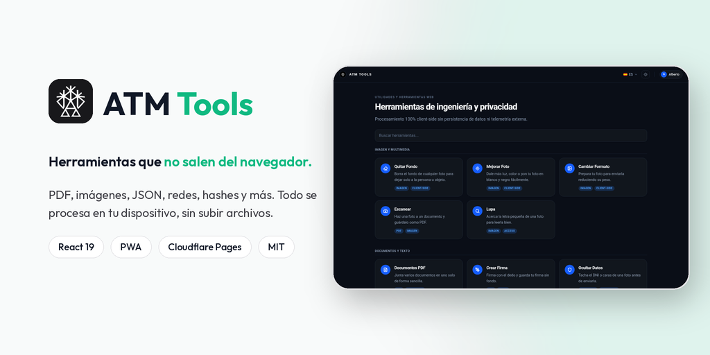
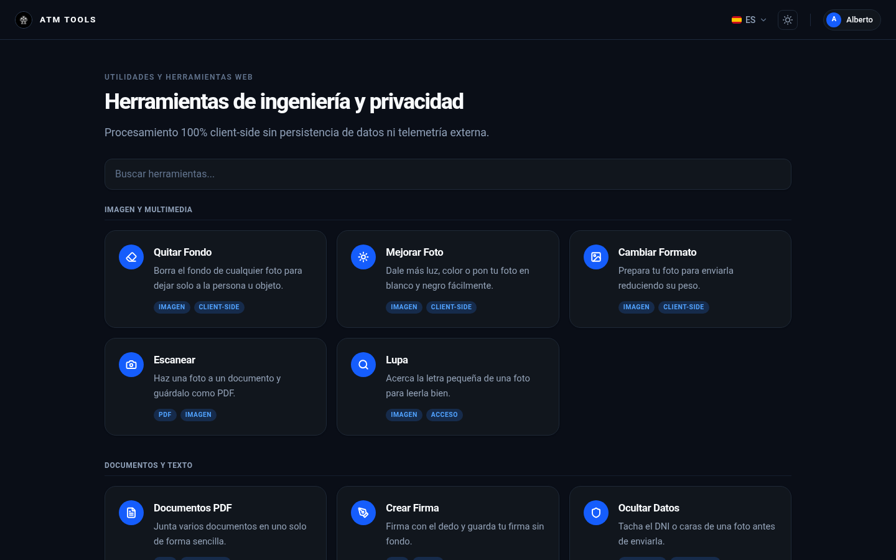
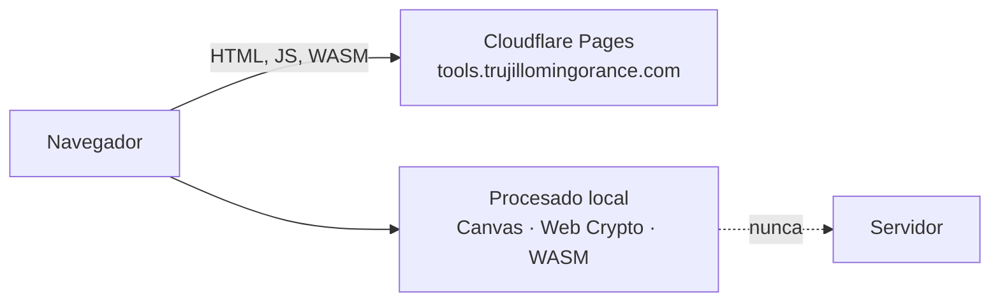

<p align="center">
  
</p>

<p align="center">
  <strong>Herramientas web para imágenes, PDF, datos y redes. Todo se procesa en tu dispositivo: no se suben archivos a ningún servidor.</strong><br/>
  <em>Client-side utilities for images, PDFs, data and networking. Nothing leaves your browser (Spanish and English UI).</em>
</p>

<p align="center">
  <a href="https://tools.trujillomingorance.com"><b>tools.trujillomingorance.com</b></a> ·
  <a href="CHANGELOG.md">Cambios</a> ·
  <a href="LICENSE">Licencia MIT</a>
</p>

<p align="center">
  
  
  
  
</p>

---

## Capturas

<p align="center"></p>

## Funciones

| Categoría | Herramientas |
|---|---|
| **Imagen** | Quitar fondo (modelo local con `@imgly/background-removal`), mejorar foto, cambiar formato y comprimir, lupa, ocultar datos (tachar DNI o caras), crear firma sin fondo |
| **PDF** | Unir documentos (`pdf-lib`, `pdfjs-dist`) y escanear con la cámara a PDF |
| **Seguridad** | Hashes (SHA-256, Keccak-256, MD5), JWT, Base64 y frases de contraseña con `crypto.getRandomValues` |
| **Datos y texto** | Formateador y minificador JSON, UUID v4 y Nanoid, conversor de fechas Unix, lectura en voz alta |
| **Redes** | Calculadora de subredes IPv4 y CIDR con máscara wildcard |
| **Web3** | Decodificador de firmas, Keccak y conversor Wei/Gwei |

- **Buscador y filtros** por categoría, y paleta de comandos con `Ctrl/Cmd + K`.
- **Español e inglés**, recordado en `localStorage`. Modo claro y oscuro.
- **PWA:** se puede instalar y funciona sin conexión.

## Stack

| Capa | Tecnología |
|---|---|
| Frontend | **React 19** · TypeScript · Vite · Tailwind CSS 4 · lucide-react |
| Procesado | APIs del navegador (Canvas, Web Crypto, Web Speech) y WebAssembly |
| Hosting | **Cloudflare Pages** (solo estáticos, sin Functions) |
| PWA | `vite-plugin-pwa` |

## Arquitectura



No hay backend: la web es una SPA estática. El único `fetch` externo es el enlace «Panel interno» común a todas las webs, que consulta la sesión en `guides.trujillomingorance.com`.

## Seguridad y privacidad

- **Procesado en memoria** dentro del navegador. No se envían imágenes, documentos, claves ni direcciones.
- **CSP estricta:** solo scripts propios (`wasm-unsafe-eval` para los modelos locales), `connect-src` limitado a la propia web y a la sesión común.
- **Cabeceras:** HSTS, `X-Frame-Options: DENY`, `nosniff`, Referrer-Policy y Permissions-Policy (la cámara solo para el escáner).

## Desarrollo local

Requisitos: **Node.js ≥ 20** y pnpm (o npm).

```bash
git clone https://github.com/ATM-Software-Labs/atm-tools.git && cd atm-tools
pnpm install
pnpm run dev           # http://localhost:5173
pnpm run lint          # oxlint
pnpm run build         # tsc -b && vite build → dist/
```

## Despliegue

El proyecto de Cloudflare Pages `atm-tools` está conectado a GitHub: cada push a `master` compila y publica en `tools.trujillomingorance.com`. No necesita variables ni secretos.

## Estructura

```
src/components/tools/   una herramienta por archivo (BackgroundRemover, PdfManager, NetworkCalc…)
src/components/layout/  Navbar, Footer, Layout y pie común
src/components/ui/      paleta de comandos y componentes base
src/utils/              i18n, crypto, imagen, PDF, compresión
public/                 _headers, iconos, robots, sitemap, atm-internal.js
docs/                   banner y capturas
```

## Licencia

[MIT](LICENSE) © 2026 ATM Software Labs · Alberto Trujillo Mingorance.

<p align="center"><sub>© 2026 ATM Software Labs · <a href="https://trujillomingorance.com">trujillomingorance.com</a></sub></p>
